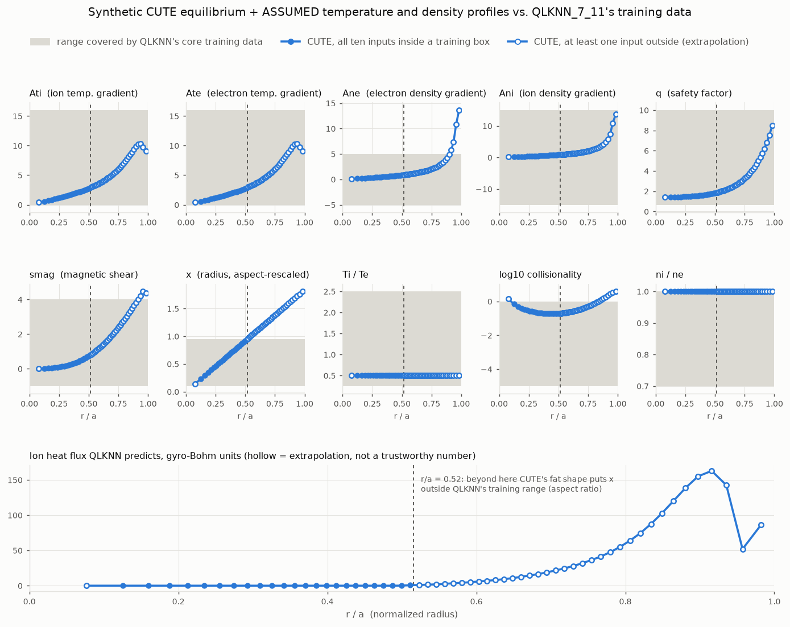

# Proof of concept: a CUTE equilibrium into DeepMind's QLKNN

**In one sentence:** this pipes one of this repo's TokaMaker equilibria of
CUTE into QLKNN_7_11, the turbulence neural network that Google DeepMind's
TORAX transport code uses by default, to find out what breaks before anyone
builds on it.

> **Status: roadblock finder, not a result.** The equilibrium is synthetic
> (solved, not reconstructed from data). The temperature and density profiles
> are **assumed placeholders**, because magnetic sensors cannot measure them.
> QLKNN is run on CUTE inputs that are mostly outside the data it was trained
> on, so its numbers are shown to locate the problems, not to be believed.

**Headline findings** (details and numbers below):

1. **CUTE is too fat for QLKNN's training data.** QLKNN was trained on
   plasmas whose minor radius is one third of their major radius. CUTE's is
   about 0.6. After the correction TORAX applies, the outer half of CUTE's
   radius (beyond r/a = 0.52) is outside the training range *whatever the
   temperature and density are*.
2. **The turbulence QLKNN predicts is all in that outer half.** Inside
   r/a = 0.52, with these assumed profiles, it predicts no turbulence at all.
   So every nonzero heat flux it gives for CUTE is an extrapolation.
3. **The geometry hand-off to TORAX works.** TORAX 1.4.3 loads TokaMaker's
   EQDSK files in both sign conventions, agrees on size and field to within
   2%, and on the q profile to a median 2.3%. A mismatched sign convention
   fails loudly rather than silently.
4. **An official TokaMaker + TORAX workflow already exists.** OFT v26.9, the
   version this repo uses, ships `TokaMaker.pulse_design.TokaMaker_TORAX`, a
   coupled pulse-design workflow (authors listed as Freddie Sheehan and John
   Lhota). The natural next step is running that on CUTE rather than growing
   this probe into a rival bridge.



---

## Background: what transport is, and what QLKNN does

**Equilibrium vs. transport.** Everything else in this repo is about the
*equilibrium*: the shape of the plasma and its magnetic field at one instant
(Primer Parts 5 and 6). Transport is the next question: given that shape, how
fast do heat and particles leak out across the field? The leak rate decides
how hot the plasma can get, so it decides whether a machine works.

**Turbulence does most of the leaking.** Steep temperature and density
gradients drive small swirls (turbulence) that carry heat outward far faster
than collisions alone would. Three kinds matter here, named after what drives
them:

- **ITG**, ion temperature gradient modes: driven by how steeply the ion
  temperature falls with radius.
- **TEM**, trapped electron modes: driven by electrons trapped on the outer,
  weaker-field side of the torus.
- **ETG**, electron temperature gradient modes: like ITG but at much smaller
  scales.

**QuaLiKiz** is a physics code that estimates these turbulent fluxes from ten
local numbers at one radius. It is far cheaper than a full turbulence
simulation, but still too slow to call thousands of times inside a transport
simulation. **QLKNN** (QuaLiKiz Neural Network) is a neural network trained on
millions of QuaLiKiz runs to reproduce its answers almost instantly. That is
the same idea as this repo's surrogate: replace a slow physics code with a
fast network trained on its output. **QLKNN_7_11** is the version in
`fusion_surrogates` 0.4.7, and the default turbulence model in TORAX.

**Gyro-Bohm units.** QLKNN gives fluxes in *gyro-Bohm* units: multiples of the
natural turbulent diffusion rate for the local temperature, field and machine
size (`chi_GB`, about 1 m^2/s for these assumed CUTE profiles). Converting to
an ordinary diffusivity in m^2/s follows TORAX's own formula.

**Why the training range matters.** A network only knows what it was shown.
Asked about inputs outside its training data (out of distribution), it still
returns a number, with no warning, and that number can be anything. This repo
learned the same lesson from the other side: its own surrogate's error bars
only hold inside the distribution it was trained on (roadmap 10.5).

## The pipeline

```
TokaMaker equilibrium of CUTE ──► shape, q, magnetic shear, R, a, B0 ─┐
                                                                      ├─► 10 inputs   ──► QLKNN_7_11 ──► turbulent heat
ASSUMED Te, Ti, ne profiles  ──► gradients, Ti/Te, collisionality ───┘   per radius      (DeepMind)      and particle flux
```

QLKNN takes ten numbers at each radius. Four come from the equilibrium, six
from temperature and density:

| Input | Meaning | Source here |
|---|---|---|
| `q` | safety factor | TokaMaker |
| `smag` | magnetic shear, `(r/q) dq/dr` | TokaMaker |
| `x` | normalized radius `r/a`, rescaled for aspect ratio | TokaMaker |
| `Ati`, `Ate` | `-R d(ln T)/dr`, ion and electron temperature gradients | **assumed** profiles |
| `Ane`, `Ani` | the same for density | **assumed** profiles |
| `Ti_Te` | ion over electron temperature | **assumed** |
| `LogNuStar` | log10 of collisionality (collisions per trapped-electron bounce) | **assumed** profiles + TokaMaker |
| `normni` | ion over electron density | **assumed** (pure plasma) |

Every formula is copied from TORAX v1.4.3 (`qualikiz_based_transport_model.py`,
`qlknn_transport_model.py`, `physics/collisions.py`), including the three
small corrections TORAX applies by default before calling QLKNN. The tests in
`tests/test_qlknn_inputs.py` check the gradients and shear against analytic
profiles and the collisionality against an independent textbook collision time
(Wesson).

## What is real and what is assumed

| Piece | Where it comes from | Honest status |
|---|---|---|
| Plasma shape, q, shear | One TokaMaker free-boundary solve on CUTE's mesh, at the middle of the shape ranges in `scripts/generate_gs_dataset.py` | Real solver, **synthetic** plasma. The pressure and current profile shapes inside it are placeholders, so q in the core is not pinned to anything measured. |
| Toroidal field `B0` = 0.57 T | `F0 = 0.17 T m` from OFT's public CUTE example | Taken from the example, not confirmed against the real machine |
| Te, Ti, ne | `KineticAssumptions` in `src/coupling/qlknn_inputs.py`: 0.2 keV on axis falling to 0.02 keV at the edge, Ti = Te/2, 1e19 m^-3 falling to 2e18, hydrogen, no impurities | **Assumed.** Plausible for a small ohmic tokamak; not CUTE data |
| Input formulas | Copied from TORAX 1.4.3 | Verified analytically in tests |
| QLKNN_7_11 | `fusion_surrogates` 0.4.7, unmodified | DeepMind's model, run as published |

The equilibrium itself (`models/qlknn_poc_equilibrium.json`): Ip 100 kA,
major radius 0.298 m, minor radius 0.183 m, elongation 1.42, triangularity
0.18, q95 6.5, limited (touching the wall rather than diverted). TokaMaker
reached a rounder, fatter shape than the requested elongation 1.7.

## Results

### 1. CUTE's shape puts half the radius outside the training data

QLKNN's main training set (QLKNN11D) was generated for one fixed proportion,
`a/R = 1/3`. Several things that drive turbulence depend on the *local*
`r/R`, chiefly how many electrons are trapped on the outer side of the torus.
TORAX compensates by rescaling the radius input:

```
x_qlknn = (r/a) * (a/R) / (1/3)
```

For this equilibrium `a/R = 0.61`, so `x_qlknn = 1.84 * r/a`. QLKNN was
trained up to `x = 0.95`, which this reaches at **r/a = 0.52**. Beyond that,
the network is extrapolating no matter what the temperature and density are.
Across the repo's 2,000 TokaMaker equilibria, `a/R` runs from 0.44 to 0.63
(using the current centroid as R), putting this limit between r/a = 0.50 and
0.72. So this is how CUTE is built, not one unlucky equilibrium.

Whether the rescaling is even a good approximation at `a/R = 0.6`, nearly
twice the training value, is a separate question this probe cannot answer.

### 2. The turbulence QLKNN predicts is all in the extrapolated region

With the assumed profiles, 24 of the 60 flux surfaces (40%, spanning
r/a = 0.13 to 0.51) have all ten inputs inside a training box. On every one
of them QLKNN predicts **zero** turbulent flux: the gradients there are below
the threshold where turbulence switches on. Turbulence switches on at
r/a = 0.51, exactly where `x` leaves the training range, and grows toward the
edge (bottom panel of the figure). Converted to diffusivities, the
extrapolated region gives ion `chi` of 1 to 4 m^2/s. That is the order of
magnitude small tokamaks are known for, but it is extrapolation, so it is not
evidence of anything.

Which inputs push surfaces outside the core training box:

| Input | Surfaces outside | CUTE range | QLKNN11D range |
|---|---|---|---|
| `x` (aspect ratio) | 35 of 60 | 0.14 to 1.81 | 0.1 to 0.95 |
| `LogNuStar` (collisionality) | 9 | -0.73 to 0.59 | -5 to 0 |
| `Ane` (density gradient) | 4 | 0.13 to 13.6 | -5 to 5 |
| `smag` (magnetic shear) | 4 | 0.005 to 4.47 | -1 to 4 |

QLKNN_7_11 also learned from a separate edge dataset (QLKNN7D), but that one
only covers `x = 0.95` exactly and `Ti = Te`, so it does not rescue CUTE's
outer half.

### 3. Collisionality: small, cold plasmas sit at the top of the range

Collisionality rises steeply as temperature falls (roughly `n / T^2`). Small
devices are cold, so they sit near or above QLKNN's limit. Fraction of flux
surfaces inside the training data as the assumed core temperature and density
vary (edge values scaled with the core):

| Te on axis | 0.5e19 m^-3 | 1e19 | 2e19 | 5e19 |
|---|---|---|---|---|
| 0.05 keV | 0% | 0% | 0% | 0% |
| 0.1 keV | 38% | 30% | 0% | 0% |
| 0.2 keV | 42% | 40% | 38% | 23% |
| 0.5 keV | 42% | 42% | 42% | 40% |
| 1.0 keV | 42% | 42% | 42% | 42% |

Two lessons: the 42% ceiling is the aspect-ratio limit, which no choice of
profiles moves. And below about 0.1 keV, collisionality alone takes the whole
plasma outside the training data.

### 4. The geometry hand-off to TORAX works

TORAX does not take QLKNN inputs from outside; it builds them from a geometry
it loads itself, usually an **EQDSK** file (a decades-old text format for one
equilibrium, also called a g-file). EQDSK files do not record their own sign
conventions (which way current flows, whether flux is divided by 2 pi), so the
reader has to be told which convention, called **COCOS**, the file uses.
TokaMaker writes COCOS 7 by default and can write COCOS 2.

`scripts/torax_geometry_probe.py` loads both through TORAX 1.4.3's EQDSK
loader (results in `models/torax_geometry_probe.json`):

| | TokaMaker | TORAX, from EQDSK |
|---|---|---|
| Major radius | 0.2981 m | 0.3004 m (+0.8%) |
| Minor radius | 0.1831 m | 0.1799 m (-1.7%) |
| B0 | 0.5702 T | 0.5660 T (-0.7%) |
| q, r/a 0.15 to 0.85 | | median 2.3% off, worst 7.9% |

- Both COCOS 7 and COCOS 2 load and give identical numbers. Declaring the
  wrong one raises an error ("No convention found that matches the given
  COCOS index 2"), so a mix-up cannot pass silently. The TORAX documentation
  still says its EQDSK reader was only tested on COCOS 2 files from CHEASE;
  in 1.4.3 it converts any declared convention through the `eqdsk` library.
- TORAX warns that COCOS 2 declares a different coordinate handedness from
  the EQDSK standard. OFT's own coupled workflow writes COCOS 2 anyway.
- A finer EQDSK grid helps the typical q difference (median 3.3% at 65
  points, 2.3% at 129, 1.8% at 257) but not the worst case (about 8%).
  **Likely, not verified:** the residual comes from where each code puts the
  edge. TORAX stops at 99% of the boundary flux by default
  (`last_surface_factor`), which would also explain its 1.7% smaller minor
  radius. OFT's coupled workflow writes EQDSKs at 300 and 900 points.

## Roadblocks, most fundamental first

1. **Aspect ratio.** CUTE (`a/R` about 0.6) is far from QLKNN's training value
   (1/3), and the outer half of the plasma is outside the data on geometry
   alone. Candidate paths: a turbulence surrogate trained for spherical
   tokamaks (`fusion_surrogates` also wraps TGLFNN-UKAEA, a surrogate of the
   TGLF turbulence code whose README lists a spherical tokamak version,
   selected as `machine="step"`; its training range has not been checked
   here), or running the slower physics code directly.
2. **No temperature or density.** Magnetic sensors cannot see them, and
   six of QLKNN's ten inputs need them. In TORAX they would be evolved from
   heating sources and boundary values, which still need numbers for CUTE.
3. **Cold-plasma collisionality.** Below about 0.1 keV, QLKNN is out of range
   everywhere.
4. **q and shear from magnetics alone are loosely pinned in the core.** This
   repo's own minor-radius finding (Primer Part 10) is a version of this: outside
   sensors fix the total current and position, not how the current is
   distributed inside, and q and shear are exactly that distribution.
5. **Shaping.** QuaLiKiz is built on a circular cross-section model; CUTE is
   elongated. TORAX passes shape only through geometric coefficients.
6. **Out-of-distribution handling.** The model's built-in input ranges are
   one box covering both training sets, which accepts points that neither
   set covers (this module checks the two boxes separately). TORAX's
   `clip_inputs` is off by default, and its source carries a TODO about
   better out-of-distribution handling.
7. **Engineering.** TORAX 1.4.3 pins `fusion_surrogates` 0.4.6 and
   `h5py<3.15`, so it needs its own environment; this probe used
   `fusion_surrogates` 0.4.7 directly.

## Open questions this raises

- Has `TokaMaker_TORAX` been run on CUTE or another spherical torus? Which
  transport model would its authors choose there, given QLKNN's aspect ratio?
- Is the `x` rescaling trusted at `a/R` near 0.6, or only close to 1/3?
- What is TGLFNN-UKAEA's spherical tokamak (`step`) version trained on, and
  would it cover CUTE?
- What do TORAX users do about out-of-distribution inputs in practice
  (`clip_inputs`, `clip_margin`, or a separate check like this one)?
- For a machine with only magnetics, what is the recommended way to set
  initial and boundary temperature and density in TORAX?
- What EQDSK resolution and `last_surface_factor` are recommended for a
  limited, low-aspect-ratio plasma, and is the ~8% worst-case q difference
  near the edge expected?

## How to run it

```bash
# Stage 1: solve the equilibrium and export geometry + EQDSK (needs OFT v26.9)
PYTHONPATH=~/opt/oft/OpenFUSIONToolkit/python:$PWD \
    python scripts/qlknn_poc.py equilibrium

# Stage 2: build inputs, check ranges, run QLKNN, write results + figure
pip install -e ".[qlknn]"
python scripts/qlknn_poc.py qlknn

# Optional: the TORAX geometry probe, in its own environment
python3.12 -m venv .venv-torax
.venv-torax/bin/pip install "torax==1.4.3"
.venv-torax/bin/python scripts/torax_geometry_probe.py
```

Stage 2 and the tests run from the committed
`models/qlknn_poc_equilibrium.json`, so they do not need OFT. The tests that
call QLKNN skip unless the `qlknn` extra is installed (CI does not install
it, as with the PyTorch tests).

## Files

| File | What it is |
|---|---|
| `src/coupling/qlknn_inputs.py` | Pure NumPy: equilibrium + assumed profiles to QLKNN inputs, training-range check, flux conversion |
| `src/coupling/qlknn_runner.py` | Loads and runs QLKNN_7_11; imports `fusion_surrogates` only when called |
| `scripts/qlknn_poc.py` | The two-stage proof of concept |
| `scripts/qlknn_poc_figure.py` | The figure above |
| `scripts/torax_geometry_probe.py` | Loads the EQDSK files through TORAX |
| `models/qlknn_poc_equilibrium.json` | The equilibrium's flux-surface geometry |
| `models/qlknn_poc_results.json` | Inputs, range report, QLKNN fluxes, assumption scan |
| `models/torax_geometry_probe.json` | TORAX vs TokaMaker geometry comparison |
| `tests/test_qlknn_inputs.py` | Analytic checks of every input formula, and a QLKNN smoke test |

`fusion_surrogates` and TORAX are Google DeepMind's open-source projects
(Apache 2.0), used here as published. This repository is not affiliated with
DeepMind or with the CUTE program.
